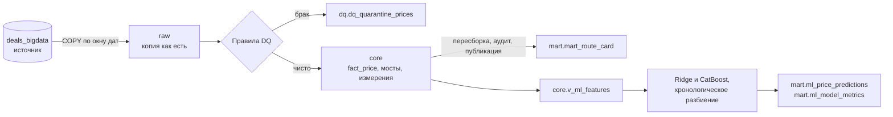

# Рыночные ставки грузоперевозок: DWH, витрины и прогноз тарифа

Сквозной прототип на PostgreSQL и Python. Он загружает сделки из операционной базы, чистит их, строит витрину рыночного коридора ставок по маршрутам и прогнозирует тариф рейса. Данные синтетические, дата снимка `as_of = 2026-10-26`.

## Запуск

Нужен Docker Compose 5.6.1. Подготовка не требуется: значения по умолчанию лежат в `.env.example`.

```bash
docker-compose up      # или docker compose up
```

Команда поднимает PostgreSQL 17, генерирует источник на 300 000 сделок и запускает весь конвейер. Когда в логе появится `pipeline_summary`, контейнер `pipeline` завершится с кодом 0, а PostgreSQL продолжит работать. Первый запуск со сборкой образа занимает 5–10 минут в зависимости от сети, запуск без сборки 2–3 минуты.

Чтобы заменить пароли или порты, скопируйте `.env.example` в `.env` и поменяйте нужные значения. Порт PostgreSQL на хосте по умолчанию `55432`.

| Действие | Команда |
|---|---|
| Повторить окно дат | `docker compose run --rm pipeline python -m etl.cli load --start-date 2026-10-01 --end-date 2026-11-01` |
| Загрузить весь источник | `docker compose run --rm pipeline python -m etl.cli load --full` |
| Пересобрать витрину | `docker compose run --rm pipeline python -m etl.cli build-marts` |
| Обучить и оценить модели | `docker compose run --rm pipeline python -m ml.train`, затем `ml.score` и `ml.ablation` |
| Весь конвейер на окне | `docker compose run --rm pipeline python -m etl.cli run-all --start-date 2026-10-01 --end-date 2026-11-01` |
| Тесты | `docker compose run --rm pipeline pytest` |
| Проверить предел качества модели | `docker compose run --rm pipeline pytest -m stand -s` |
| Примеры SQL | `docker compose exec -T postgres sh -c 'psql -U "$POSTGRES_USER" -d "$DWH_DB"' < sql/queries/examples.sql` |
| Удалить всё | `docker compose down -v` |

После загрузки окна витрину нужно пересобрать: `load` меняет только `raw`, `core` и карантин.

## Проверка результата

Витрины можно читать из любого SQL-клиента или BI-инструмента под ролью только для чтения. Дашборда в проекте нет.

| Параметр | Значение |
|---|---|
| Хост и порт | `localhost:55432` |
| База | `dwh` |
| Пользователь | `bi_reader` |
| Пароль | `BI_PASSWORD` из `.env.example` |

Самые плотные маршруты за месяц:

```sql
select loading_city, unloading_city, body_group, weight_category,
       p25_trip, median_trip, p75_trip, median_km, trips_count, carriers_count, reliability_level
from mart.v_route_network
where month = date '2026-09-01'
  and reliability_level <> 'LOW_DATA'
order by trips_count desc
limit 10;
```

История коридора одного маршрута:

```sql
select month, p25_trip, median_trip, p75_trip, trips_count, mom_pct, yoy_pct, reliability_level
from mart.v_route_history
where loading_city = 'Москва'
  and unloading_city = 'Ростов-на-Дону'
  and body_group = 'Тент'
  and weight_category = 'FTL'
order by month desc
limit 13;
```

Рейсы заметно выше прогноза:

```sql
select price_id, loading_date, loading_city, unloading_city,
       actual_price_rub, predicted_price_rub, deviation_pct, p75_trip
from mart.v_fact_vs_forecast
where split = 'test'
  and is_above_forecast
  and not outlier_mark
order by deviation_pct desc
limit 10;
```

Остальные проверки лежат в [sql/queries/examples.sql](sql/queries/examples.sql): дубли зерна, карантин, баланс сделок, метрики моделей и журнал запусков.

## Архитектура



Python управляет процессом и переносит данные через `COPY`. Трансформации выполняет SQL внутри PostgreSQL (ELT), построчных вставок нет. Один контейнер содержит две базы: `deals_bigdata` (роль `source_reader` только читает) и `dwh` со схемами `raw`, `core`, `dq`, `mart`, `ops`.

| Каталог | Содержимое |
|---|---|
| `sql/ddl/` | Схемы и таблицы всех слоёв, идемпотентный DDL |
| `sql/transform/` | Загрузка окна: `raw`, измерения, карантин, факт, мосты, аудиты |
| `sql/mart/` | Эталонный запрос `route_card.sql`, публикация, аудиты, представления |
| `sql/queries/` | Примеры запросов для проверки |
| `etl/` | Конфигурация, извлечение, загрузка, витрины, журнал запусков, CLI |
| `ml/` | Признаки, разбиение, бейзлайны, обучение, скоринг, абляция |
| `tests/` | Unit-тесты, интеграционные тесты на отдельных базах, проверка предела качества на стенде |
| `docker/` | Образ конвейера и заполнение источника |

### Выбор стека

- **PostgreSQL 17.** База источника занимает около 300 МБ, транзакция сразу даёт атомарную перезапись окна. `percentile_cont` считает точные перцентили.
- **Python и psycopg 3.** `COPY` между базами идёт потоком без промежуточных файлов. SQLAlchemy здесь нечего абстрагировать.
- **CLI как оркестратор.** Логика не зависит от планировщика, поэтому её можно вызывать из cron или DAG теми же командами.
- **CatBoost поверх Ridge.** Ridge на логарифме цены задаёт уровень, CatBoost учится на его остатках и работает с категориями без кодирования. Сравнение вариантов в разделе про ML.

Сознательно не используются:

| Технология | Почему нет | Когда пересмотреть |
|---|---|---|
| Spark, Hadoop | Данные помещаются на одну машину с большим запасом | Объём перестал помещаться на узел |
| Kafka | Пакетная загрузка, задержки в минуты не нужны | Нужны минуты, а не часы |
| Trino | Источник один | Появится несколько источников |
| Iceberg, S3 | Атомарность уже есть в транзакции PostgreSQL | Появится озеро и несколько движков |
| dbt, Great Expectations | SQL-файлов и аудитов «ноль строк значит PASS» пока хватает | Много моделей и команд |
| Партиции PostgreSQL | PK должен включать ключ партиции, теряется глобальная уникальность `price_id` | Таблицы вырастут до десятков ГБ |

Airflow, Superset и ClickHouse пока не подключены: конвейер запускается из CLI, витрины читаются напрямую из PostgreSQL.

## Этап 1: загрузка и качество данных

Окно задаётся полуинтервалом `[start, end)` по `prices.loading_date`. Шаг `load` работает так:

1. Берёт `pg_advisory_lock`, чтобы два прогона не меняли хранилище одновременно.
2. Читает источник одним снимком `REPEATABLE READ READ ONLY`, поэтому сделки и связанные строки согласованы.
3. Через `COPY` переносит данные во временные таблицы.
4. В одной транзакции заменяет срез `raw`, обновляет измерения, заполняет карантин, факт и мосты, запускает аудиты.
5. Пишет результат в `ops.pipeline_runs`. Этот журнал ведётся отдельным соединением и сохраняет запись о сбое после отката.

**Идемпотентность.** Факты перезаписываются через `DELETE + INSERT`: upsert не убрал бы сделку, которая исчезла из источника или ушла в карантин. Удаляются строки окна и все `price_id` из загружаемого набора. Второе условие нужно для сделки, у которой изменилась `loading_date`. `ON CONFLICT` используется только для справочников. Повторный запуск проверен построчными хэшами `raw`, `core`, `dq`, витрины и прогнозов.

**Карантин.** Отбракованные сделки лежат в `dq.dq_quarantine_prices` вместе с исходной строкой в `raw_row`. Одна сделка может иметь несколько кодов причин. Если сделку исправили в источнике, при повторной загрузке окна она покидает карантин.

| Код | Условие | Сделок |
|---|---|---:|
| `PRICE_NON_POSITIVE` | `price <= 0` | 164 |
| `FX_RATE_MISSING` | Валюта не RUB и нет точного курса по `nearest_rate_date` | 39 |
| `RUB_PRICE_TOO_LOW` | RUB и `0 < price <= 1000` | 0 |
| `DISTANCE_NON_POSITIVE` | `distance <= 0` | 0 |
| `WEIGHT_NEGATIVE`, `VOLUME_NEGATIVE` | Отрицательный вес или объём | 0 |
| `VALUE_NOT_FINITE` | `NaN` или бесконечность в цене, дистанции, весе или объёме | 0 |
| `FX_RATE_INVALID` | Курс найден, но не положителен или не конечен | 0 |
| `PRICE_RUB_OUT_OF_RANGE` | От 1 млрд руб. за рейс или за км, либо валютная сделка дешевле 1 руб. | 0 |
| `LOADING_CITY_NOT_FOUND`, `UNLOADING_CITY_NOT_FOUND` | Города нет в `cities` | 0 |

Итог: 299 797 сделок в `core`, 203 в карантине. Правила с нулевым счётчиком на этих данных не срабатывают, они проверены тестами на фикстурах. Совпадение городов отправления и назначения правилом не считается.

**Валюта.** `price_rub` считается один раз при загрузке. Для RUB `price_rub = price`, и пустая `nearest_rate_date` здесь не ошибка: таких сделок 1 428. Для USD и EUR берётся курс на сохранённую `nearest_rate_date`. Сохранённая дата не подменяется и пустая не заполняется, поэтому такие сделки уходят в карантин. Отдельный аудит пересчитывает ожидаемую дату по правилу «последний курс не позже `created_at`, иначе `MIN(setting_date) > created_at`» и сообщает о расхождениях. На этих данных их 0.

**Категории.** Пропуски заполняются функциями `core.weight_category` и `core.volume_category`. Вес округляется в `numeric`: на `double precision` значение 2,45 т округлилось бы до 2,4 и попало в другую категорию.

## Этап 2: витрина

`mart.mart_route_card` имеет зерно `месяц × город отправления × город назначения × группа кузова × весовая категория`. Запрос лежит в [sql/mart/route_card.sql](sql/mart/route_card.sql).

- **Города.** `core.dim_city` хранит одну запись на `gc_id` с минимальным `cities.id`. Прямой join с `cities` по обоим городам дал бы 412 672 строки вместо 300 000.
- **Кузова.** `core.bridge_price_body_group` хранит пары сделка × группа без повторов. Без связи берётся `prices.body_type`, а при `NULL` группа `Не указан`. 35 280 сделок входят в две группы, поэтому `trips_count` нельзя суммировать по кузовам.
- **Месяц.** Берётся из `price_dates`, поэтому многомесячная сделка входит в каждый свой месяц. Будущие даты отсекаются построчно: у 3 824 строк сделка историческая, а дата плановая.
- **Перцентили.** `percentile_cont` с линейной интерполяцией. Агрегаты считаются после приведения к одной строке на сделку, месяц и кузов, иначе дубли исказили бы среднее и `stddev`.
- **MoM и YoY.** Считаются по `median_trip` (руб./рейс) через `LEFT JOIN` на календарный месяц. `LAG` не подходит: при пропуске месяца он взял бы последний доступный.
- **Свежесть.** `freshness_days = as_of - max(price_date в ячейке)`, условие `HIGH` выполняется при значении не больше 30.

**Обновление.** Витрина пересобирается целиком: MoM и YoY зависят от соседних месяцев, а одна сделка попадает в несколько месяцев, поэтому окно загрузки не равно месяцу витрины. Сборка занимает несколько секунд. Результат пишется во временную таблицу и проходит аудиты, после чего в той же транзакции заменяет рабочую таблицу. Если аудит не пройден, читатели продолжают видеть прошлую версию.

| Показатель | Значение |
|---|---:|
| Ячеек | 203 644 |
| С одним рейсом | 159 375 (78 %) |
| `trips_count >= 10` | 934 |
| `HIGH` / `MEDIUM` / `LOW_DATA` | 10 / 924 / 202 710 |
| Ячеек с `mom_pct` / `yoy_pct` | 75 986 / 42 624 |

Почти все ячейки имеют `LOW_DATA`: зерно мелкое, а сделок 300 000. Для BI нужен фильтр по надёжности.

Представления: `mart.v_route_network` (сводная таблица с коридором, средним и метриками доверия), `mart.v_route_history` (история маршрута), `mart.v_fact_vs_forecast` (факт рядом с прогнозом и коридором, флаг рейсов выше прогноза на 30 %). Роль `bi_reader` читает только схему `mart`.

## Этап 3: модель

Таргет `price_rub`. Выборка: `is_fact`, `not complex`, `price_rub > 0`, `distance > 0`.

| Выборка | Период по `loading_date` | Строк |
|---|---|---:|
| `train` | `[2026-07-26, 2026-10-05)`, без `outlier_mark` | 24 226 |
| из него `val` | `[2026-09-21, 2026-10-05)` | 5 523 |
| `test` | `[2026-10-05, 2026-10-26]` | 13 078 (12 808 без `outlier_mark`) |
| `future` | `> 2026-10-26` | 4 891 |

Параметры выбираются на `val` по WAPE, затем модель дообучается на всём `train` с найденным числом итераций. MAPE для выбора не подходит: она поощряет заниженный прогноз. Метрики всегда считаются в рублях.

| Вариант на `val` | WAPE, % | MAPE, % |
|---|---:|---:|
| CatBoost на рублях, `depth=6` | 14,12 | 15,48 |
| CatBoost на `ln(price_rub)`, `depth=6` | 13,58 | 13,62 |
| **Ridge на `ln(price_rub)`, CatBoost на остатках, `depth=4`** | **13,51** | **13,42** |

Деревья инвариантны к монотонным преобразованиям признаков, но не таргета: при MSE логарифм меняет оптимум. Факторы цены перемножаются, поэтому в логарифме связь почти линейна. Ridge быстро находит уровень, а деревья уточняют остаток и почти не зависят от `seed`: разброс MAPE на периодах проверки 0,01 п. п. против 0,11 п. п. у бустинга без Ridge.

В Ridge нет календаря намеренно. `train` покрывает июль – октябрь, и с календарём прогноз на январь падал до 72 руб./км при обычных 100. На периодах проверки этого не видно, поэтому уровень прогноза по месяцам сверяется отдельно: сейчас от 99,6 до 102,5 руб./км.

**Признаки** заданы белым списком в [ml/features.py](ml/features.py): дистанция, вес, объём, регионы и города отправления и назначения, координаты, кузов, категории, `price_type`, календарь и гармоники месяца, дня недели и дня года. Ridge получает те же признаки без календаря и ещё `ln(distance)`, его квадрат и `1/distance`: цена складывается из ставки на км и постоянной части.

**Защита от утечек:**

- `price_group_stats` и `price_group_id` не загружаются в хранилище, а `source_reader` не имеет прав на эту таблицу.
- `ml.train` читает только строки раньше `2026-10-05`: тестовый период в процесс обучения не попадает. Тест это проверяет.
- Импутация, масштаб и кодирование обучаются внутри `sklearn.Pipeline`, то есть только на `train`.
- Перечень запрещённых полей зафиксирован тестом.

**Метрики на test** (строки без `outlier_mark`, 12 808):

| Модель | R² | MAPE, % | RMSE, руб. | MAE, руб. | MdAPE, % |
|---|---:|---:|---:|---:|---:|
| **Ridge + CatBoost** | **0,9293** | **13,62** | **50 859** | **25 825** | **10,84** |
| Только Ridge на логарифме | 0,9271 | 13,59 | 51 642 | 26 176 | 11,06 |
| Медиана руб./км × дистанция | 0,7172 | 42,78 | 101 726 | 62 112 | 25,45 |

На всех 13 078 строках, включая размеченные выбросы, основная модель даёт R² 0,8050, MAPE 16,98 %, RMSE 91 196, MAE 32 526. Срезы по кузову, дистанции и весу лежат в `mart.ml_model_metrics`.

MAPE у одного Ridge чуть ниже только за счёт занижения: его медианное смещение 3,5 % против 1,5 % у основной модели, а RMSE и MAE хуже. Выигрыш основной модели подтверждён парным бутстрэпом: у Ridge + CatBoost относительно CatBoost на логарифме WAPE ниже на 0,18 п. п. (95 % ДИ 0,11–0,26), MAE на 352 руб. (205–506).

**Предел качества.** Точная формула генератора без шума на тех же строках даёт R² 0,9314, MAPE 13,59 %, WAPE 13,08 %, RMSE 50 112, MAE 25 508. Из этих 13,59 % шум даёт 12,8 %, остальное 54 неразмеченные аномалии. Модель отстаёт на 1,5 % по RMSE и 1,2 % по MAE, поэтому заметно меньшая ошибка означала бы утечку. MAPE предел строго не ограничивает: для логнормального шума её минимум лежит ниже медианы, и та же формула с занижением на 2,5 % даёт 13,42 %. Поэтому MAPE читается только вместе со смещением. R² здесь высок почти бесплатно, потому что цена почти пропорциональна дистанции: внутри бакетов дистанции он падает до 0,66–0,88. Сравнивать важнее с бейзлайном и по MAE. Предел проверяется тестом [tests/stand/test_noise_floor.py](tests/stand/test_noise_floor.py): он запускает генератор с тем же зерном без шума и аномалий.

**Абляция** (`ml/ablation.py`, те же параметры и строки):

| Вариант | R² | MAPE, % | MAE, руб. |
|---|---:|---:|---:|
| Основная модель | 0,9293 | 13,62 | 25 825 |
| Без `price_type` | 0,9260 | 14,11 | 26 684 |
| С намеренной утечкой ₽/км текущего рейса | 0,9821 | 6,92 | 12 775 |

`price_type` известен до цены и влияет на неё: медиана на `train` равна 97,4 / 98,4 / 87,5 / 93,5 руб./км для типов 1 / 2 / 3 / 9. Третья строка показывает, как выглядит утечка: ошибка падает ниже уровня шума. Эта модель пишет только метрики.

**Файлы модели.** `ml.train` пишет их в новый каталог и переключает символьную ссылку `current` одним действием, поэтому при сбое обучения остаётся прошлый согласованный набор. Скоринг и абляция читают файлы под той же блокировкой, что и обучение.

**Скоринг.** `ml.score` пишет прогнозы `test` и `future` в `mart.ml_price_predictions` одной транзакцией: `DELETE` по `model_name` и `COPY`. У `future` поля `actual_price_rub`, `abs_error_rub`, `ape_pct` равны `NULL`, это закреплено ограничением таблицы. Прогнозы воспроизводятся: повтор обучения и скоринга дал те же значения.

## Известные ограничения

- **`outlier_mark` последнего дня.** Сделки, созданные после ночной разметки `2026-10-26 02:30`, не размечены: 4 862 факта. У всех них `loading_date` в будущем, поэтому на витрину и `test` это не влияет. Сделки с `loading_date = 2026-10-26` размечены как обычно.
- **Неразмеченные аномалии.** Генератор искажает цену чаще, чем ставит флаг: примерно 0,4 % строк имеют аномальную цену при `outlier_mark = false`. Они немного сдвигают `avg_trip` и `cv_rate`, медиана устойчива. Флаг намеренно не пересчитывается.
- **Неполный октябрь 2026.** `mom_pct` сравнивает неполный месяц с полным, такие строки отмечены `is_partial_month`.
- **Сезонность модели.** `train` занимает 71 день одного года, поэтому годовую сезонность и тренд модель не выучивает, а деревья не экстраполируют. Прогноз на ноябрь – февраль стоит на уровне октября и не отражает декабрьский пик. На `test` модель занижает цену примерно на 1,5 %: октябрь дороже сентября, а этого в `train` нет. Обучение на всей истории с трендом сняло смещение (−0,4 %) и дало RMSE 50 424, MAE 25 761, но это другое окно обучения, поэтому в основной модели его нет.
- **Смешанный таргет.** В `price_rub` входят заявки заказчика, экспедитора и перевозчика, разница частично учтена через `price_type`.
- **Перенос сделки за окно.** Если `loading_date` сделки ушла за пределы перезагружаемого окна, она пропадёт из `raw` и `core` до загрузки своего нового окна. Такие сделки считает предупреждающий аудит `deal_left_window`, вместе с удалёнными из источника. Загрузка всего источника вернёт их сразу.
- **Заморозка курса.** Изменение курса в источнике попадёт в `price_rub` только после повторной загрузки окна.
- **Будущие заявки в скоринге.** Прогноз строится только для фактов по прямым маршрутам: из 6 003 заявок с датой после `as_of` оценены 4 891. Ещё 1 109 это ставки торгов и составные маршруты, 3 лежат в карантине.
