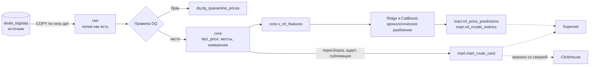
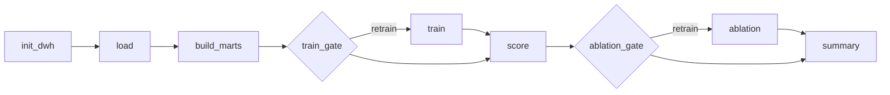

# Рыночные ставки грузоперевозок: DWH, витрины и прогноз тарифа

Прототип на PostgreSQL и Python. Он забирает сделки из операционной базы, чистит их, строит витрину рыночного коридора ставок по маршрутам и прогнозирует тариф рейса. Данные синтетические, дата снимка `as_of = 2026-10-26`.

## Запуск

Нужен Docker Compose 5.6.1. Готовить ничего не нужно, значения по умолчанию лежат в `.env.example`.

```bash
docker-compose up      # или docker compose up
```

Поднимается PostgreSQL 17, генерируется источник на 300 000 сделок и отрабатывает весь конвейер. Когда в логе появится `pipeline_summary`, контейнер `pipeline` завершится с кодом 0, а PostgreSQL останется работать. Первый запуск со сборкой образа идёт 5–10 минут, в зависимости от сети, без сборки 2–3 минуты.

Пароли и порты меняются в `.env`: скопируйте туда `.env.example` и поправьте нужное. PostgreSQL по умолчанию слушает на хосте порт `55432`.

| Что сделать | Команда |
|---|---|
| Повторить окно дат | `docker compose run --rm pipeline python -m etl.cli load --start-date 2026-10-01 --end-date 2026-11-01` |
| Загрузить весь источник | `docker compose run --rm pipeline python -m etl.cli load --full` |
| Пересобрать витрину | `docker compose run --rm pipeline python -m etl.cli build-marts` |
| Обучить и оценить модели | `docker compose run --rm pipeline python -m ml.train`, затем `ml.score` и `ml.ablation` |
| Весь конвейер на окне | `docker compose run --rm pipeline python -m etl.cli run-all --start-date 2026-10-01 --end-date 2026-11-01` |
| Тесты | `docker compose run --rm pipeline pytest` |
| Проверить предел качества модели | `docker compose run --rm pipeline pytest -m stand -s` |
| Примеры SQL | `docker compose exec -T postgres sh -c 'psql -U "$POSTGRES_USER" -d "$DWH_DB"' < sql/queries/examples.sql` |
| Удалить всё, включая данные профилей | `docker compose --profile superset --profile airflow --profile clickhouse down -v` |

`load` меняет только `raw`, `core` и карантин, так что после загрузки окна витрину надо пересобрать.

Superset, Airflow и ClickHouse включаются профилями compose. Без профиля `docker-compose up` поднимает только основную часть.

| Компонент | Команда | Адрес | Вход |
|---|---|---|---|
| Superset | `docker-compose --profile superset up` | http://localhost:8088 | `admin` / `local_superset_admin_change_me` |
| Airflow | `docker-compose --profile airflow up` | http://localhost:8081 | `admin` / `local_airflow_admin_change_me` |
| ClickHouse | `docker-compose --profile clickhouse up` | http://localhost:58123 | `market` / `local_clickhouse_change_me` |

Это значения по умолчанию из `.env.example`: `SUPERSET_ADMIN_PASSWORD`, `_AIRFLOW_WWW_USER_PASSWORD` и `CLICKHOUSE_PASSWORD`. Образам каждого профиля нужно до 3,5 ГБ на диске, так что при нехватке места лучше поднимать их по одному. Подробнее в разделе [Дополнительные компоненты](#дополнительные-компоненты).

## Проверка результата

Витрины читаются из любого SQL-клиента или BI под ролью только для чтения. Готовый дашборд есть в профиле `superset`.

| Параметр | Значение |
|---|---|
| Хост и порт | `localhost:55432` |
| База | `dwh` |
| Пользователь | `bi_reader` |
| Пароль | `BI_PASSWORD` из `.env.example` |

Самые плотные маршруты за месяц:

```sql
select loading_city, unloading_city, body_group, weight_category,
       p25_trip, median_trip, p75_trip, median_km, trips_count, carriers_count, reliability_level
from mart.v_route_network
where month = date '2026-09-01'
  and reliability_level <> 'LOW_DATA'
order by trips_count desc
limit 10;
```

История коридора одного маршрута:

```sql
select month, p25_trip, median_trip, p75_trip, trips_count, mom_pct, yoy_pct, reliability_level
from mart.v_route_history
where loading_city = 'Москва'
  and unloading_city = 'Ростов-на-Дону'
  and body_group = 'Тент'
  and weight_category = 'FTL'
order by month desc
limit 13;
```

Рейсы заметно дороже прогноза:

```sql
select price_id, loading_date, loading_city, unloading_city,
       actual_price_rub, predicted_price_rub, deviation_pct, p75_trip
from mart.v_fact_vs_forecast
where split = 'test'
  and is_above_forecast
  and not outlier_mark
order by deviation_pct desc
limit 10;
```

Ещё несколько проверок (дубли зерна, карантин, баланс сделок, метрики моделей, журнал запусков) лежат в [sql/queries/examples.sql](sql/queries/examples.sql). Полный порядок ручной проверки с ожидаемыми значениями и хэшами таблиц я описал в [docs/manual-testing.md](docs/manual-testing.md).

## Архитектура



Пунктиром отмечено то, что включается профилями compose.

Python управляет процессом и переносит данные через `COPY`, а трансформации делает SQL внутри PostgreSQL (ELT). Построчных вставок нет. В одном контейнере две базы: `deals_bigdata`, которую роль `source_reader` только читает, и `dwh` со схемами `raw`, `core`, `dq`, `mart`, `ops`.

| Каталог | Что внутри |
|---|---|
| `sql/ddl/` | Схемы и таблицы всех слоёв, DDL можно запускать повторно |
| `sql/transform/` | Загрузка окна: сверка снимка источника, `raw`, измерения, карантин, факт, мосты, аудиты |
| `sql/mart/` | Запрос витрины `route_card.sql`, публикация, аудиты, представления |
| `sql/queries/` | Запросы для проверки |
| `etl/` | Конфигурация, извлечение, загрузка, витрины, журнал запусков, CLI |
| `ml/` | Признаки, разбиение, бейзлайны, обучение, скоринг, абляция |
| `tests/` | Unit-тесты, интеграционные тесты на отдельных базах, проверка предела качества |
| `docker/` | Образы, заполнение источника, запуск Airflow |
| `dags/` | DAG Airflow и разбор параметров запуска |
| `superset/` | Настройки Superset и файлы дашборда |
| `sql/clickhouse/` | Таблица зеркала витрины и примеры запросов |
| `docs/` | Порядок ручной проверки |
| `.github/workflows/` | Тесты в GitHub Actions: тот же compose, маленький источник и `pytest` на PostgreSQL 17 |

### Почему такой стек

PostgreSQL 17 здесь с запасом: база источника весит около 300 МБ, транзакция сама даёт атомарную перезапись окна, а `percentile_cont` считает точные перцентили. Между базами данные идут через `COPY` в psycopg 3, потоком и без промежуточных файлов. SQLAlchemy я не брал, абстрагировать тут нечего.

Вся логика запускается из CLI и от планировщика не зависит. DAG Airflow вызывает те же команды, поэтому результат одинаковый с оркестратором и без него.

Модель двухступенчатая: Ridge на логарифме цены задаёт уровень, CatBoost учится на его остатках и сам работает с категориями. Почему именно так, написано в разделе про модель.

Чего здесь нет и почему:

| Технология | Почему нет | Когда пересмотреть |
|---|---|---|
| Spark, Hadoop | Данные с большим запасом помещаются на одну машину | Объём перестал помещаться на узел |
| Kafka | Загрузка пакетная, задержки в минуты не нужны | Понадобятся минуты, а не часы |
| Trino | Источник один | Появится несколько источников |
| Iceberg, S3 | Атомарность уже даёт транзакция PostgreSQL | Появится озеро и несколько движков |
| dbt, Great Expectations | Пока хватает SQL-файлов и аудитов «ноль строк значит PASS» | Станет много моделей и команд |
| Партиции PostgreSQL | Ключ партиции пришлось бы включить в PK, и `price_id` перестал бы быть уникальным глобально | Таблицы вырастут до десятков ГБ |

## Загрузка и качество данных

Окно загрузки задаётся полуинтервалом `[start, end)` по `prices.loading_date`. Шаг `load`:

1. заводит запись в `ops.pipeline_runs` и берёт `pg_advisory_lock`, чтобы два прогона не меняли хранилище одновременно. Ждёт её не дольше `PIPELINE_LOCK_TIMEOUT` (по умолчанию 15 минут), а потом падает с ошибкой «Хранилище занято другим прогоном». Так задача Airflow не висит молча, пока идёт ручной `run-all`. Запись появляется раньше блокировки, поэтому и ожидание, и такой отказ видны в журнале;
2. читает источник одним снимком `REPEATABLE READ READ ONLY`, чтобы сделки и связанные с ними строки были согласованы;
3. переносит данные через `COPY` во временные таблицы;
4. сверяет снимок с тем, что уже лежит в `raw`, и останавливается, если источник отдал его неполным (об этом ниже);
5. одной транзакцией заменяет срез `raw`, обновляет измерения, заполняет карантин, факт и мосты и запускает аудиты;
6. пишет итог в `ops.pipeline_runs`. Журнал ведётся отдельным соединением, поэтому запись о сбое переживает откат. Если упал аудит, в `details.audits` остаётся число нарушений по каждой проверке файла, а в `details.audit_samples` первые пять строк каждого нарушения, обычно `price_id` или ключ ячейки. Те же строки пишутся в лог в поле `sample`, в том числе для предупреждающих аудитов.

Пока шаг идёт, соединение журнала держит advisory-блокировку на свой `run_id`. Если процесс убили, блокировка снимается вместе с соединением, и запись `running` больше никто не ведёт. Следующий шаг находит такие записи и закрывает их как `failed`, а в `details` пишет причину и `closed_by_run`. Записи живых шагов, в том числе зеркала ClickHouse, которое работает без общей блокировки, он не трогает.

Логи пишутся в JSON, одна строка на событие. Предупреждающие аудиты идут с уровнем `WARNING`, упавшие аудиты и шаги с уровнем `ERROR`, поэтому сбои отбираются по полю `level`.

Факты перезаписываются через `DELETE + INSERT`. Upsert тут не годится: он не уберёт сделку, которая пропала из источника или ушла в карантин. Удаляются строки окна и вдобавок все `price_id` из загружаемого набора. Второе нужно на случай, если у сделки поменялась `loading_date`. `ON CONFLICT` остался только у справочников, и строку он переписывает, только если она изменилась. Поэтому `_batch_id` у справочника показывает загрузку, которая строку поменяла, а не последнюю. Повторный запуск я проверял построчными хэшами `raw`, `core`, `dq`, витрины и прогнозов.

У такой перезаписи есть обратная сторона: если источник отдал неполный снимок, загрузка честно сотрёт то, чего в нём нет. Пустой `cities` отправил бы в карантин все сделки окна, пустой `exchange_rates` все валютные, а пустое окно удалило бы себя из `raw` и `core`. Каждая строка такого снимка проходит правила DQ, так что остальные аудиты его пропускают. Поэтому до любых изменений [sql/transform/source_audits.sql](sql/transform/source_audits.sql) сверяет снимок с `raw`:

| Аудит | Когда останавливает загрузку |
|---|---|
| `source_reference_empty` | Справочник `cities`, `body_types` или `exchange_rates` пришёл пустым |
| `source_reference_shrank` | Из справочника пропало больше `SOURCE_SHRINK_LIMIT` строк (по умолчанию 5 %) |
| `source_window_shrank` | Из окна пропало больше `SOURCE_SHRINK_LIMIT` сделок и при этом не меньше 100 |

Порог в 100 сделок нужен для маленьких окон: там удаление пары сделок даёт большую долю, но о сбое не говорит. Поштучные пропажи по-прежнему считает предупреждающий `deal_left_window`. Если строки удалены намеренно, загрузку повторяют с `SOURCE_SHRINK_LIMIT=1`, например `docker compose run --rm -e SOURCE_SHRINK_LIMIT=1 pipeline python -m etl.cli load --full`. Я проверил это на полном источнике: после очистки `cities` загрузка окна в 29 640 сделок упала с этой подсказкой, и в хранилище ничего не изменилось.

Отбракованные сделки лежат в `dq.dq_quarantine_prices` вместе с исходной строкой в `raw_row`. У одной сделки может быть несколько причин. Если сделку исправили в источнике, после повторной загрузки окна она из карантина уходит.

| Код | Условие | Сделок |
|---|---|---:|
| `PRICE_NON_POSITIVE` | `price <= 0` | 164 |
| `FX_RATE_MISSING` | Валюта не RUB и нет точного курса по `nearest_rate_date` | 39 |
| `RUB_PRICE_TOO_LOW` | RUB и `0 < price <= 1000` | 0 |
| `DISTANCE_NON_POSITIVE` | `distance <= 0` | 0 |
| `WEIGHT_NEGATIVE`, `VOLUME_NEGATIVE` | Отрицательный вес или объём | 0 |
| `VALUE_NOT_FINITE` | `NaN` или бесконечность в цене, дистанции, весе или объёме | 0 |
| `FX_RATE_INVALID` | Курс найден, но не положителен или не конечен | 0 |
| `PRICE_RUB_OUT_OF_RANGE` | От 1 млрд руб. за рейс или за км, меньше 1 коп. за км, либо валютная сделка дешевле 1 руб. | 0 |
| `LOADING_CITY_NOT_FOUND`, `UNLOADING_CITY_NOT_FOUND` | Города нет в `cities` | 0 |

В итоге в `core` 299 797 сделок, в карантине 203. Правила с нулём на этих данных не срабатывают, их покрывают тесты на фикстурах. Одинаковые города отправления и назначения я браком не считаю.

Границы `PRICE_RUB_OUT_OF_RANGE` технические, они держат значения в разрядности витрины. С ними рубль за рейс лежит в `[1, 1e9)`, а рубль за км в `[0.01, 1e9)`. Под эти диапазоны подобраны типы: изменение медианы за рейс меньше 1e11 % и помещается в `numeric(14, 2)`, изменение за км меньше 1e13 % и помещается в `numeric(16, 2)`. Без нижней границы ставка дешевле копейки за км округлилась бы в витрине до нуля и уронила бы аудит коридора, а изменение к ней не уместилось бы ни в какой тип. Одна такая сделка остановила бы обновление витрины целиком. Минимальная ставка в сгенерированном источнике 0,063 руб./км, так что правило ничего не отсекает.

`price_rub` считается один раз, при загрузке. Для RUB это просто `price`, и пустая `nearest_rate_date` тут не ошибка: таких сделок 1 428. Для USD и EUR берётся курс на сохранённую `nearest_rate_date`. Эту дату я не подменяю и пустую не заполняю, такие сделки уходят в карантин. Отдельный аудит пересчитывает, какой должна быть дата по правилу «последний курс не позже `created_at`, иначе `MIN(setting_date) > created_at`», и сообщает о расхождениях. На этих данных их 0.

Пропуски категорий заполняют функции `core.weight_category` и `core.volume_category`. Вес округляется в `numeric`: в `double precision` 2,45 т округлилось бы до 2,4 и попало не в ту категорию.

## Витрина

Зерно `mart.mart_route_card`: `месяц × город отправления × город назначения × группа кузова × весовая категория`. Запрос лежит в [sql/mart/route_card.sql](sql/mart/route_card.sql).

Что пришлось учесть:

- `gc_id` в `cities` повторяется. `core.dim_city` хранит одну запись на `gc_id`, с минимальным `cities.id`. Прямой join с `cities` по обоим городам дал бы 412 672 строки вместо 300 000.
- Обратная проблема: разные `gc_id` могут называться одинаково, в России много одноимённых посёлков. Витрины, сводка и признаки модели берут название из `core.v_city_label`. Если название повторяется, к нему дописывается регион, например «Октябрьский (Республика Башкортостан)». Если совпал и регион, дописывается ещё `gc_id`. Без этого два города склеились бы в одно направление сводки, и её сверка с карточкой маршрута остановила бы сборку витрины. В сгенерированном источнике все 40 названий разные, так что подписи совпадают с названиями.
- У сделки может быть несколько кузовов. `core.bridge_price_body_group` хранит пары сделка × группа без повторов. Если связей нет, берётся `prices.body_type`, а при `NULL` группа `Не указан`. В две группы попадают 35 280 сделок, поэтому складывать `trips_count` по кузовам нельзя.
- Месяц берётся из `price_dates`, и многомесячная сделка входит в каждый свой месяц. Будущие даты отсекаются построчно: у 3 824 строк сделка историческая, а дата плановая.
- Перцентили считает `percentile_cont` с линейной интерполяцией. Агрегаты считаются уже после того, как на сделку, месяц и кузов осталась одна строка, иначе дубли исказили бы среднее и `stddev`.
- Отбор сделок и эту дедупликацию делает функция `core.market_deal_months(as_of)`, общая для карточки маршрута и сводки рынка, так что правило записано один раз. PostgreSQL встраивает её в запрос, и по времени сборка не изменилась. Аудиты витрин считают отбор заново и сами, чтобы проверка не зависела от того, что проверяет.
- MoM и YoY считаются по `median_trip` (руб./рейс) через `LEFT JOIN` на календарный месяц. `LAG` не подходит: если месяц пропущен, он возьмёт последний доступный.
- Свежесть: `freshness_days = as_of - max(price_date в ячейке)`. Для `HIGH` она должна быть не больше 30.

Витрина пересобирается целиком. MoM и YoY зависят от соседних месяцев, а одна сделка попадает в несколько месяцев, так что окно загрузки с месяцем витрины не совпадает. Сборка идёт около минуты. Результат сначала пишется во временную таблицу и проходит аудиты, потом в той же транзакции подменяет рабочую. Если аудит не прошёл, читатели продолжают видеть прошлую версию.

| Показатель | Значение |
|---|---:|
| Ячеек | 203 644 |
| С одним рейсом | 159 375 (78 %) |
| `trips_count >= 10` | 934 |
| `HIGH` / `MEDIUM` / `LOW_DATA` | 10 / 924 / 202 710 |
| Ячеек с `mom_pct` / `yoy_pct` | 75 986 / 42 624 |

Почти все ячейки `LOW_DATA`: зерно мелкое, а сделок всего 300 000. В BI без фильтра по надёжности не обойтись.

Для чтения есть три представления. `mart.v_route_network` даёт сводную таблицу с коридором, средним и метриками доверия. `mart.v_route_history` даёт историю маршрута. `mart.v_fact_vs_forecast` ставит факт рядом с прогнозом и коридором и отмечает рейсы дороже прогноза на 30 %. Сделка `test` сравнивается с коридором своего месяца погрузки. У будущей заявки такого месяца в витрине ещё нет, поэтому она получает коридор последнего месяца своей ячейки, а сам месяц показан в `corridor_month`. Так коридор есть у 4 653 из 4 891 будущей заявки, а при сравнении только по месяцу погрузки он был бы у 105. У 2 944 из них это октябрь 2026, у остальных месяц старше, и давность видна по `corridor_month` и `reliability_level`. Роль `bi_reader` читает только схему `mart`.

### Сводка рынка

`mart.mart_market_summary` нужна для вопросов уровня рынка: какая ставка по всем направлениям, по кузову, по длине плеча. Из карточки маршрута это не собрать, медианы и перцентили не складываются. Поэтому сводка заранее считает срез на каждое сочетание фильтров: месяц × направление × кузов × вес × плечо, где `Все` значит «без фильтра». Любой выбор фильтров читает ровно одну строку.

Сделка с двумя кузовами входит в обе группы, но в срез `Все` попадает один раз: этот срез считается по сделкам, а не по строкам с кузовами. Плечо делится по дистанции сделки на `до 300 км`, `300–1000 км` и `1000+ км`.

В сводке есть ставка в ₽/км (P25, медиана, P75), медиана за рейс, число перевозок, изменение медианы ₽/км к прошлому месяцу и к январю того же года. Мини-график `trend_km` показывает последние 12 месяцев, в которых были рейсы.

Перед публикацией срезы по направлению, кузову и весу сверяются с `mart_route_card`, а срез `Все` пересчитывается по сделкам из `core`. Платить за это приходится 1,03 млн строк, 288 МБ и примерно 50 секундами к сборке витрины.

## Модель

Таргет `price_rub`, выборка `is_fact`, `not complex`, `price_rub > 0`, `distance > 0`.

| Выборка | Период по `loading_date` | Строк |
|---|---|---:|
| `train` | `[2026-07-26, 2026-10-05)`, без `outlier_mark` | 24 226 |
| из него `val` | `[2026-09-21, 2026-10-05)` | 5 523 |
| `test` | `[2026-10-05, 2026-10-26]` | 13 078 (12 808 без `outlier_mark`) |
| `future` | `> 2026-10-26` | 4 891 |

Параметры я подбираю на `val` по WAPE, потом модель дообучается на всём `train` с найденным числом итераций. По MAPE выбирать нельзя, она поощряет заниженный прогноз. Метрики везде считаются в рублях.

| Вариант на `val` | WAPE, % | MAPE, % |
|---|---:|---:|
| CatBoost на рублях, `depth=6` | 14,12 | 15,48 |
| CatBoost на `ln(price_rub)`, `depth=6` | 13,58 | 13,62 |
| **Ridge на `ln(price_rub)`, CatBoost на остатках, `depth=4`** | **13,51** | **13,42** |

Деревьям всё равно, как монотонно преобразованы признаки, но не таргет: при MSE логарифм сдвигает оптимум. Факторы цены перемножаются, и в логарифме связь почти линейная. Ridge быстро находит уровень, деревья уточняют остаток и почти не зависят от `seed`: разброс MAPE на периодах проверки 0,01 п. п., у бустинга без Ridge 0,11 п. п.

Календаря в Ridge нет, и это намеренно. `train` покрывает июль – октябрь, и с календарём прогноз на январь падал до 72 руб./км при обычных 100. На периодах проверки этого не видно, поэтому уровень прогноза по месяцам я сверяю отдельно: сейчас медиана прогноза будущих заявок по месяцам от 100,3 до 103,2 руб./км.

Признаки заданы белым списком в [ml/features.py](ml/features.py): дистанция, вес, объём, регионы и города отправления и назначения, координаты, кузов, категории, `price_type`, календарь и гармоники месяца, дня недели и дня года. Ridge получает то же без календаря, плюс `ln(distance)`, его квадрат и `1/distance`, потому что цена складывается из ставки на км и постоянной части.

От утечек защищает несколько вещей:

- `price_group_stats` и `price_group_id` в хранилище не загружаются, а у `source_reader` нет прав на эту таблицу;
- модель, по которой считаются метрики `test`, обучается только на строках раньше `2026-10-05`. Тестовый период `ml.train` читает уже после неё, и он попадает только в модель для будущих заявок (об этом ниже). Тесты проверяют порядок чтения и то, что прогнозы `test` не меняются, если поменять цены `test`;
- у каждого прогноза `trained_through`, последняя дата обучающих данных его модели, раньше `loading_date`, и это держит ограничение таблицы;
- импутация, масштабирование и кодирование обучаются внутри `sklearn.Pipeline`, то есть только на `train`;
- список запрещённых полей закреплён тестом.

Метрики на test, 12 808 строк без `outlier_mark`:

| Модель | R² | MAPE, % | RMSE, руб. | MAE, руб. | MdAPE, % |
|---|---:|---:|---:|---:|---:|
| **Ridge + CatBoost** | **0,9293** | **13,62** | **50 859** | **25 825** | **10,84** |
| Только Ridge на логарифме | 0,9271 | 13,59 | 51 642 | 26 176 | 11,06 |
| Медиана руб./км × дистанция | 0,7172 | 42,78 | 101 726 | 62 112 | 25,45 |

Если взять все 13 078 строк вместе с размеченными выбросами, у основной модели R² 0,8050, MAPE 16,98 %, RMSE 91 196, MAE 32 526. Срезы по кузову, дистанции и весу лежат в `mart.ml_model_metrics`.

У одного Ridge MAPE чуть ниже, но только потому, что он занижает прогноз: медианное смещение 3,5 % против 1,5 % у основной модели, а RMSE и MAE у него хуже. Что основная модель действительно лучше, я проверил парным бутстрэпом: по сравнению с CatBoost на логарифме у Ridge + CatBoost WAPE ниже на 0,18 п. п. (95 % ДИ 0,11–0,26), MAE на 352 руб. (205–506).

### Предел качества

Точная формула генератора без шума на тех же строках даёт R² 0,9314, MAPE 13,59 %, WAPE 13,08 %, RMSE 50 112, MAE 25 508. Из этих 13,59 % на шум приходится 12,8 %, остальное дают 54 неразмеченные аномалии. Модель отстаёт на 1,5 % по RMSE и на 1,2 % по MAE. Заметно меньшая ошибка означала бы утечку.

MAPE этим пределом строго не ограничена. Для логнормального шума её минимум лежит ниже медианы, и та же формула с занижением на 2,5 % даёт 13,42 %. Поэтому MAPE я смотрю только вместе со смещением. R² тут высокий почти даром, потому что цена почти пропорциональна дистанции: внутри бакетов дистанции он падает до 0,66–0,88. Важнее сравнение с бейзлайном и MAE.

Предел проверяет тест [tests/stand/test_noise_floor.py](tests/stand/test_noise_floor.py): он запускает генератор с тем же зерном, но без шума и аномалий.

### Абляция

`ml/ablation.py` обучает варианты с теми же параметрами и на тех же строках:

| Вариант | R² | MAPE, % | MAE, руб. |
|---|---:|---:|---:|
| Основная модель | 0,9293 | 13,62 | 25 825 |
| Без `price_type` | 0,9260 | 14,11 | 26 684 |
| С намеренной утечкой ₽/км текущего рейса | 0,9821 | 6,92 | 12 775 |

`price_type` известен до цены и на неё влияет: медиана на `train` 97,4 / 98,4 / 87,5 / 93,5 руб./км для типов 1 / 2 / 3 / 9. Третья строка показывает, как выглядит утечка: ошибка уходит ниже уровня шума. Эта модель пишет только метрики.

### Файлы модели и скоринг

`ml.train` пишет файлы в новый каталог и одним действием переключает на него символьную ссылку `current`. Метрики `val` записываются и коммитятся раньше, чем переключается ссылка, поэтому новая модель появляется только вместе со своими метриками. Если обучение или запись метрик упадёт, останутся прошлые файлы и прошлые метрики. Скоринг и абляция читают файлы под той же блокировкой, что и обучение.

Каждая версия файлов лежит в своём каталоге `release-*`. Его имя, `run_id` шага обучения и границы выборок записаны в `train_meta.json`, а у прогнозов и метрик версия хранится в колонке `model_release`. Так по прогнозу видно, какой набор файлов его дал. В `ops.pipeline_runs` шаги `ml-train`, `ml-score` и `ml-ablation` держат ту же версию в `details.model_release`, а у `ml-score` там же есть `train_run_id`. Ключи таблиц не менялись: в них лежит результат последней версии, а не история. Метрики `val` получают новую версию сразу при обучении, прогнозы и метрики `test` после скоринга.

Скоринг и абляция сверяют записанные границы с теми, что дают текущие `AS_OF` и правила разбиения, и при расхождении падают с подсказкой переобучить модель. Иначе после смены `AS_OF` выборка `test` могла бы лечь на строки, на которых модель обучалась, и метрики вышли бы завышенными без всякого предупреждения. Версию без записанных границ скоринг тоже не принимает, её нужно обучить заново.

Обучение даёт две модели с одинаковыми параметрами и числом итераций. Первая обучена на `train` и оценивает строки `test`, по ней считаются все метрики. Вторая обучена на всей истории до `as_of` включительно, то есть на `train` и `test` без `outlier_mark`, 37 034 строки, и оценивает будущие заявки. К дате снимка цены `test` уже известны, а без них прогноз отставал бы от рынка на три последние недели: на `test` первая модель занижает цену на 1,5 %, потому что октябрь дороже сентября. Вторая этот уровень видит, и её прогноз на ноябрь – декабрь на 1,8–1,9 % выше, на январь – февраль на 0,8–0,9 %. Проверить вторую модель на фактах нельзя, их у будущих заявок ещё нет, поэтому её качество я оцениваю по первой. Какая модель дала прогноз, видно по колонке `trained_through`: у `test` там `2026-10-04`, у `future` `2026-10-26`. Скоринг принимает только версию, в которой есть обе модели.

`ml.score` пишет прогнозы `test` и `future` в `mart.ml_price_predictions` одной транзакцией: `DELETE` по `model_name`, затем `COPY`. У `future` поля `actual_price_rub`, `abs_error_rub` и `ape_pct` пустые, это держит ограничение таблицы. Прогнозы воспроизводятся: повторное обучение и скоринг дали те же значения.

## Дополнительные компоненты

### Superset

Дашборд «Рынок ставок: маршруты и прогноз» создаётся при запуске из файлов в `superset/assets/`, в интерфейсе ничего настраивать не надо. Повторный запуск обновляет объекты, а не плодит копии. Superset ходит в базу под ролью `bi_reader` и видит только схему `mart`. Пароль подставляется из окружения, в файлах репозитория вместо него маска.

| Вкладка | Что показывает | Фильтры |
|---|---|---|
| Обзор рынка | Индекс ставок, ставка за рейс, изменение с начала года, число перевозок, коридор в ₽/км, тепловая карта кузов × плечо, ставки по кузовам, топ-10 направлений | Месяц, направление, кузов, тоннаж, плечо |
| Маршрутная сеть | Сводная таблица ячеек за месяц | Месяц, надёжность. `LOW_DATA` по умолчанию скрыт, иначе таблица почти целиком из ячеек с одним рейсом |
| История маршрута | Коридор P25, медиана и P75 по месяцам, таблица с MoM и YoY | Откуда, куда, кузов, вес |
| Факт и прогноз | Метрики на `test`, медианы факта и прогноза по дням, сравнение моделей, рейсы дороже прогноза | Нет |

Готовые статистики дашборд не агрегирует: медианы нельзя усреднять, а рейсы нельзя складывать по кузовам. Поэтому таблицы показывают строки витрины как есть, а фильтры обзора и истории обязательны и выбирают ровно одну строку на месяц. `MAX` на графиках и карточках просто возвращает значение этой строки. Запрет на агрегацию закреплён тестом на файлы дашборда.

Обзор рынка повторяет компоновку макета продукта, но там, где этого требуют данные, отличается. Зерно витрины месячное, поэтому вместо недель и «4 недель» показаны месяцы. Типа груза в источнике нет, и такого фильтра тоже нет. Самосвалы, контейнеры и тралы попадают в `Прочие`. Изменения показаны со знаком, но без цвета: таблица Superset 6.0 не умеет красить текст по значению.

Две вещи на дашборде похожи на неполадку, но так и задумано. В заголовках таблиц «Топ-10 направлений» и «200 рейсов с наибольшим превышением прогноза» стоит жёлтый ⚠ с подсказкой «The row limit set for the chart was reached». Обе таблицы показывают первые N строк по сортировке, поэтому лимит срабатывает всегда, и Superset об этом предупреждает. Карточка «Индекс ставок» залита оранжевым специально: заливка задана в поле `css` файла `superset/assets/dashboards/market_rates.yaml`.

### Airflow

DAG `ul_market_pipeline` вызывает те же команды CLI, что и обычный запуск. Конвейер стоит в образе в отдельном окружении, чтобы его версии `numpy` и `pandas` не спорили с ограничениями Airflow.



| Запуск | Окно | Обучение |
|---|---|---|
| По расписанию, `@daily` | `[data_interval_start − 35 дней, data_interval_end + 120 дней)` | Нет, применяется готовая модель |
| `{"full": true, "retrain": true}` | Весь источник | Да |
| `{"start_date": "2026-10-01", "end_date": "2026-11-01"}` | Заданное окно | Нет |

Плановый запуск перегружает не один вчерашний день. Заявки заводятся заранее: на дату снимка в источнике лежат заявки с погрузкой до `as_of + 110` дней. Из 278 заявок, созданных 25 октября, 178 грузятся позже этого дня, и окно в один день подхватило бы только 100. Окно с отступами подхватывает все. Вперёд я беру 120 дней, это 110 с запасом. Назад беру 35 дней: так перегружаются недавние сделки, если их поправили или удалили в источнике, а это 30 дней порога свежести витрины и ещё несколько дней на пропущенные запуски. В окне около 30 тысяч сделок, загрузка занимает примерно 5 секунд против 2,5 за один день. Окна `full` и `start_date`/`end_date` из `conf` отступы не меняют. Окно отсчитывается от интервала запуска, а не от `AS_OF`.

`catchup` выключен. Данные зафиксированы на `as_of`, окна будущих заявок ещё не наступили, и догонять расписание незачем. Вместо этого контейнер `airflow-trigger` один раз запускает DAG на всём окне и завершается с его статусом. Перед ним отрабатывает обычный `pipeline`, поэтому ежедневный запуск сразу находит готовую модель. Повтор на тех же данных заодно проверяет идемпотентность.

Запустить вручную: `docker compose --profile airflow exec airflow-scheduler airflow dags trigger ul_market_pipeline --conf '{"start_date": "2026-10-01", "end_date": "2026-11-01"}'`.

### ClickHouse

Контейнер `clickhouse-mirror` копирует `mart.mart_route_card` в `market.mart_route_card`. Это зеркало готовой витрины, а не второй расчёт: точные перцентили и `count distinct` не собираются из частей, поэтому их считает только PostgreSQL.

Таблица на `ReplacingMergeTree` с партициями по месяцу. `ORDER BY` начинается с ключей маршрута, потому что карточку обычно фильтруют по ним. Города и категории хранятся как `LowCardinality(String)`, деньги как `Decimal`.

Новая версия собирается в `mart_route_card_staging`, сверяется с PostgreSQL и подменяет рабочую таблицу через `EXCHANGE TABLES`, так что читатели видят либо старую версию, либо новую. Сверка идёт по каждому месяцу: число строк, суммы всех числовых показателей и число непустых значений. Если что-то не сошлось, публикация отменяется и контейнер завершается с ошибкой.

Примеры запросов лежат в [sql/clickhouse/examples.sql](sql/clickhouse/examples.sql), запускать так: `docker compose --profile clickhouse exec -T clickhouse sh -c 'clickhouse-client --user "$CLICKHOUSE_USER" --password "$CLICKHOUSE_PASSWORD" -d "$CLICKHOUSE_DB" --multiquery' < sql/clickhouse/examples.sql`.

После пересборки витрины зеркало нужно обновить: `docker compose --profile clickhouse run --rm --no-deps clickhouse-mirror`.

## Известные ограничения

- Сделки, созданные после ночной разметки `2026-10-26 02:30`, не размечены по `outlier_mark`: это 4 862 факта. У всех них `loading_date` в будущем, так что на витрину и `test` это не влияет. Сделки с `loading_date = 2026-10-26` размечены как обычно.
- Генератор портит цену чаще, чем ставит флаг: примерно у 0,4 % строк цена аномальная при `outlier_mark = false`. Они немного сдвигают `avg_trip` и `cv_rate`, медиана к ним устойчива. Флаг я намеренно не пересчитываю.
- Октябрь 2026 неполный, и `mom_pct` сравнивает его с полным сентябрём. Такие строки отмечены `is_partial_month`.
- `train` занимает 71 день одного года, поэтому годовую сезонность и тренд модель не выучивает, а деревья не экстраполируют. Прогноз на ноябрь – февраль остаётся на уровне октября и декабрьский пик не отражает. На `test` модель занижает цену примерно на 1,5 %: октябрь дороже сентября, а в `train` этого нет. Модель для будущих заявок обучена и на `test`, так что октябрьский уровень она знает, но тренд дальше октября не продолжает. Обучение на всей истории с трендом убрало смещение (−0,4 %) и дало RMSE 50 424, MAE 25 761, но это уже другое окно обучения, поэтому в основную модель я его не взял.
- В `price_rub` смешаны заявки заказчика, экспедитора и перевозчика. Разница частично учтена через `price_type`.
- Если `loading_date` сделки ушла за пределы перезагружаемого окна, сделка пропадёт из `raw` и `core`, пока не загрузят её новое окно. Такие сделки, как и удалённые из источника, считает предупреждающий аудит `deal_left_window`, а массовую пропажу останавливает `source_window_shrank`. Загрузка всего источника сразу их вернёт. Ежедневное окно Airflow сдвигается само: сделка, перенесённая дальше чем на 120 дней вперёд, вернётся, когда до её погрузки останется 120 дней. Сделка, перенесённая больше чем на 35 дней назад, без ручной загрузки её окна не вернётся. Правки сделок с погрузкой больше 35 дней назад ежедневный запуск тоже не видит.
- Курс в `price_rub` заморожен: изменение курса в источнике попадёт туда только после повторной загрузки окна.
- Прогноз строится только для фактов по прямым маршрутам: из 6 003 заявок с датой после `as_of` оценены 4 891. Из оставшихся 1 112 заявок 1 109 это ставки торгов и составные маршруты, а 3 лежат в карантине с `PRICE_NON_POSITIVE`: у них `price = 0`. Цена в признаки не входит, так что прогноз для них посчитать можно. Но модель берёт данные только из `core.v_ml_features`, а сделок из карантина там нет. Отдельный путь к признакам в обход этого представления ради трёх строк я заводить не стал.
